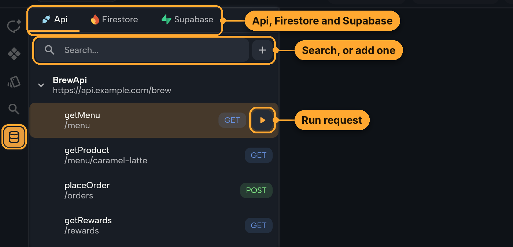
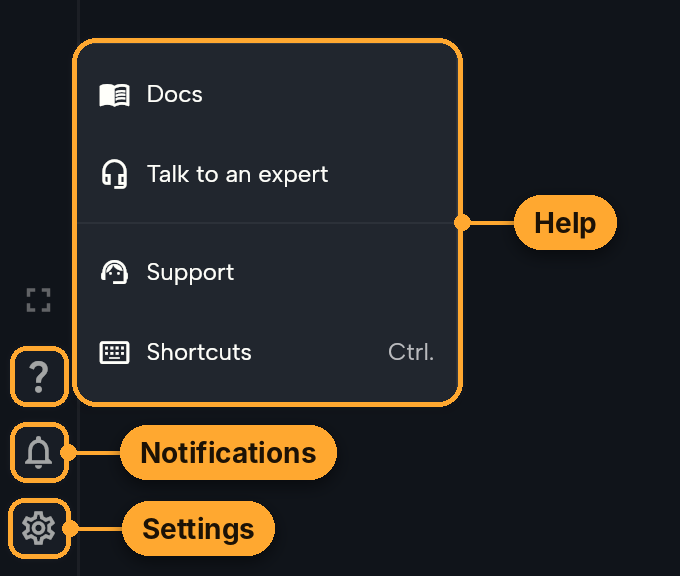

# Videos and screenshots

A visual earns its place when it shows something words can't: a flow in motion, or where something new lives on screen. Every visual on the page should make the value obvious at a glance.

## Video, screenshot or nothing

| Use | When | Past examples |
|---|---|---|
| **Video** | The value is in something happening: a flow, a change you watch take effect, something moving | Instant play, editing while the app plays, switching the boards to Arabic and translating |
| **Annotated screenshot** | The value is where something is or what a panel holds: a new panel, button or menu | Comments and Share in Instant play, the Data panel, the Help menu |
| **Nothing** | One sentence explains it, or users can't see it | Lottie previews, several GitHub accounts, Nowa AI being faster |

- About one or two videos and zero to three screenshots per page. Put them on the biggest sections first.
- Never a visual for a fix, an unannotated full-screen screenshot, or one that only decorates.
- One flow per video, 15 to 25 seconds.

## Specs and where files go

| | Format | Where | Name |
|---|---|---|---|
| Video | MP4, H.264 High, level 4.1 or lower, 1920x1080, 30 fps, fast start, no sound | `static/videos/whats-new/` | `<version>-<topic>.mp4`, like `3.16.4-languages.mp4` |
| Poster | JPG, a frame of the video | same folder | same name, `.jpg` |
| Screenshot | PNG, cropped to what matters, about 1400 to 1600 px wide (narrower for a small menu) | `static/img/whats_new/` | `<version>-<topic>.png` |

`yarn check:videos` checks the video specs, file name case and fast start. Embed them like this:

```md
<video controls playsInline preload="metadata" width="100%" poster="/videos/whats-new/3.16.4-languages.jpg">
  <source src="/videos/whats-new/3.16.4-languages.mp4" type="video/mp4" />
</video>




```

The alt text says what's on screen and what's highlighted. Use the `` form for a small image that shouldn't stretch.

## What to show

- **Capture the released version.** The web app at `https://app.nowa.dev` shows its version in the status bar, like `v3.16.4-87`. If the release isn't live yet, ask whether to wait or to build the web app from the branch (see the `nowaproj/nowa` README) and record from that build.
- **A small, real-looking demo app.** The 3.16 videos and screenshots used a coffee shop app ("What are you craving today?", Caramel Latte, Iced Matcha, an Order now button). Reuse that look so the pages feel like one story, and keep its content short and believable.
- **Nothing private**: demo names only, no real emails, keys or projects.
- **No noise in frame.** The signed-out playground shows "Could not open the last chat" in the status bar. Zoom or crop so error messages, toasts and banners stay out.

## Recording a video

The scripts drive the web app in Chromium with Playwright. `record.cjs` draws a pointer and click ripples (headless browsers have no cursor) and keeps every frame Chromium paints. `encode.cjs` makes a steady 30 fps MP4 and the poster, with optional cuts and zooms. Keep takes, frames and scratch scripts outside the repo, so only the finished MP4, JPG and PNG files get committed.

### Setup

- **Playwright and Chromium.** In Claude Code on the web they're already installed. On a computer, install them in a scratch folder outside the repo: `npm i playwright && npx playwright install chromium`, then run take scripts with `NODE_PATH=<scratch folder>/node_modules`.
- **ffmpeg and ffprobe** on the PATH.
- **The playground needs no account**: `https://app.nowa.dev/playground`. It keeps its project in the browser's local storage, so a demo you build there stays between takes in the same browser context.
- **For a feature that needs an account** (the AI chat, cloud projects, GitHub), sign in once in a visible browser and save the session, then pass it to `open()`:

  ```js
  const { chromium } = require('playwright');
  (async () => {
    const browser = await chromium.launch({ headless: false });
    const context = await browser.newContext();
    const page = await context.newPage();
    await page.goto('https://app.nowa.dev');
    await page.waitForTimeout(120000); // sign in by hand in the window
    await context.storageState({ path: '/tmp/nowa-session.json' });
    await browser.close();
  })();
  // later: rec.open({ url: 'https://app.nowa.dev/...', storageState: '/tmp/nowa-session.json' })
  ```

  Use a demo account, never someone's real projects, and don't commit the session file.
- **Desktop-only features** (local projects, the Linux app) can't be recorded in the web app. Ask the person to record the flow with their own screen recorder, then encode it with the same settings:

  ```sh
  ffmpeg -i recording.mov -vf "fps=30,scale=1920:1080:force_original_aspect_ratio=decrease,pad=1920:1080:(ow-iw)/2:(oh-ih)/2,format=yuv420p" \
    -an -c:v libx264 -profile:v high -level:v 4.1 -preset slow -crf 20 -movflags +faststart out.mp4
  ```

### Plan the take

1. Write down the flow in three to six beats, like: open **Details** on an empty spot, pick Arabic, select a text marked **not translated**, type the translation, show the board in Arabic.
2. Open the app and take a screenshot to find where things are:

   ```js
   const rec = require('<this skill>/scripts/record.cjs');
   (async () => {
     const { browser, page } = await rec.open(); // the playground, 1280x720 at 1.5x
     await rec.shot(page, '/tmp/plan.png');
     await browser.close();
   })();
   ```

   Look at the screenshot. It's 1920x1080, so divide the pixel positions you read off it by 1.5 to get the CSS pixels `glide()` and `click()` take. Nowa is drawn on a canvas, so there are no DOM elements to query: reading positions off screenshots is the way. Don't turn on Flutter's accessibility tree (`flt-semantics-placeholder`) to find things, because typing into text fields stops working when it's on.
3. Set up the demo before recording starts, so the take shows only the feature.

### Record

```js
const rec = require('<this skill>/scripts/record.cjs');
(async () => {
  const { browser, page } = await rec.open();
  // ...set up the demo here, before recording...
  const take = await rec.start(page, '/tmp/take-languages');
  await rec.pause(page, 1000);                 // a calm first frame
  await rec.glide(page, 1100, 250);            // move like a person, 0.6 s
  await rec.click(page);                       // ripple and click
  await rec.pause(page, 1200);                 // let the viewer see the result
  await rec.type(page, 'اطلب الآن');           // types one key at a time
  await rec.pause(page, 1800);                 // end on the result
  console.log(await take.stop());              // { frames, seconds, fps }
  await browser.close();
})();
```

Pacing that worked:

- Pointer moves take 0.6 to 0.9 seconds, and there's a pause of 1 to 1.5 seconds after every result.
- Start on a calm frame and hold the final result for about 2 seconds.
- Click a text field before typing into it, and type at about 60 to 80 ms a key. Keys typed while no field has focus trigger board shortcuts (**T**, **R**, **V**).
- Do it in one take. If something misfires, fix the script and record again rather than patching.

### Encode

```sh
node <this skill>/scripts/encode.cjs /tmp/take-languages static/videos/whats-new/3.16.4-languages.mp4 \
  --cut 0-0.4,8.2-15.6 --zoom /tmp/zoom.json --poster 12
```

- `--cut` removes stretches of the raw take, in seconds, like waiting for Nowa AI.
- `--zoom` eases in to where the action is, so small UI stays readable, and back out to show the whole board. Times are of the finished video. Repeat a view to hold it:

  ```json
  [ { "t": 0,   "view": "full" },
    { "t": 1.2, "view": "full" },
    { "t": 2.0, "view": [1180, 60, 740] },
    { "t": 7.5, "view": [1180, 60, 740] },
    { "t": 8.3, "view": "full" } ]
  ```

  A view is `[x, y, width]` in 1920x1080 pixels, and the height follows from 16:9. Keep the width at 960 or more (2x at most), or the picture gets soft. Zoom when the action happens in a small part of the screen, and skip it when the whole screen is the point. The owner said zooms help but aren't needed in every video.
- `--poster` picks the poster frame, in seconds of the finished video. Pick a frame that shows the result, since it's also the page's share image.

### Check it before using it

Make a frame sheet and look at it:

```sh
ffmpeg -v error -i out.mp4 -vf "fps=1/2,scale=640:-1,tile=4x3" -frames:v 1 /tmp/sheet.png
```

Check that each beat is there, text is readable, the pointer lands on the right things, nothing private or noisy is in frame, and the zooms frame the action. Then run `yarn check:videos`. Keep the file small: 20 seconds is usually 1 to 3 MB.

## Annotating a screenshot

1. Take the screenshot with `rec.shot(page, file)`. The recording pointer is hidden unless you pass `{ pointer: true }`.
2. Write a spec. Positions are in pixels of the screenshot:

   ```json
   { "crop": [560, 0, 1360, 760],
     "callouts": [
       { "box": [1680, 6, 104, 48], "label": "Run", "at": [1500, 200] },
       { "box": [1834, 150, 40, 40], "round": true, "label": "Show Grid", "at": [1650, 420] }
     ] }
   ```

3. Run `node <this skill>/scripts/annotate.cjs shot.png spec.json static/img/whats_new/<version>-<topic>.png`.

The house style is an orange outline around each thing to look at, joined by a line to an orange label pill, like `static/img/whats_new/3.16.1-comments.png`. Use one to four callouts, labels in the words on screen (**Comment · C**, **Share**, **Fix with AI · Resolve**) or a few plain words (**Pinned on your app**), and crop to the part of the screen that matters. Look at the result before using it: labels shouldn't cover what they point at, and lines shouldn't cross.
